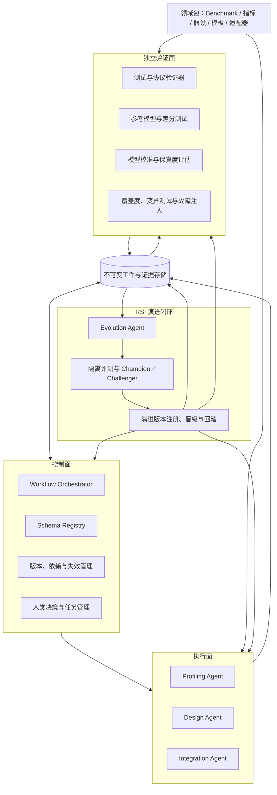

# 通用微架构混合仿真 Agent 工作流设计文档

**版本**：v2.2  
**定位**：设计原理、系统架构与验证规范，不是具体执行计划  
**适用对象**：需要从 Benchmark、微架构归因、RTL 实现到系统级混合仿真与结果归因的研究流程  
**首个领域试点**：SME2 LUI 查表单元与 streaming SVE mode 下的多向量写回路径，对比 SVE2 基线  
**核心目标**：让研究结论可追溯、可证伪、可复现、可定位，而不是仅让流程自动运行

---

## 1. 问题定义

### 1.1 研究问题

对于一种候选指令、数据通路或微架构优化，平台需要回答：

1. 在指定负载和系统配置下，是否产生可观测的性能变化？
2. 性能变化来自什么机制，而不是仅与哪些指标相关？
3. 该机制在当前仿真模型中是否成立，其结论适用范围是什么？
4. 模型内部因果结论在何种证据条件下可以外推至目标硬件？
5. 当结果异常或不符合预期时，能否定位到观测、归因、方案、接口、实现、集成、配置或分析中的具体环节？

SME2 是该通用问题的首个实例，不构成平台边界。平台应能够替换 ISA、Benchmark、瓶颈类型、RTL 单元和仿真适配器。

### 1.2 工程与方法论问题

传统流程通常由研究者手动完成 Profiling、归因、方案设计、RTL 实现、仿真对接和结果分析。其主要问题不是效率低，而是：

- 观测、推断、建议和人类判断混杂，无法区分证据等级；
- 自然语言设计意图与实际代码逐渐偏离；
- 测试通过被误当作语义正确或研究结论成立；
- 工件、测试和环境版本变化后，旧结论仍被继续使用；
- 最终异常只能在链路末端发现，且缺少可靠的定位手段；
- 仿真模型内部成立的因果关系被直接外推为目标硬件规律。

因此，本平台不是“一键生成仿真结论”的黑盒，而是一个**受控研究系统**：Agent 负责机械转换和候选生成，人类负责高权重判断，独立验证体系负责限制共同误解和错误放行。

### 1.3 设计目标

- **可追溯**：任何结论均可追溯到工件、观测、实验、决策和环境版本。
- **可证伪**：关键假设必须具有预测方向、失败条件和替代解释。
- **可复现**：测试结论绑定工件、配置、依赖和运行环境。
- **可定位**：通过验证分层、证据图和故障注入支持单层及跨层根因定位。
- **可替换**：Agent、领域包、模板和仿真组件可以独立替换。
- **可渐进自动化**：低风险环节可自动接受，高风险判断保留显式人类确认。

### 1.4 非目标

- 不承诺全自动证明微架构因果关系。
- 不将测试通过等同于实现绝对正确。
- 不将仿真内部因果等同于真实硬件因果。
- 不做 STA、面积或功耗签核。
- 不在基线与实验组保真度不可比时输出精细周期优势结论。
- 不以“链路跑通”作为平台有效性的充分证据。

---

## 2. 核心设计原则

### 2.1 Spec、工件与接口契约分离

三个概念承担不同职责：

- **Spec**：记录设计意图、约束、假设、验收标准和决策理由，用于审计与验证。
- **工件（Artifact）**：实际生成并可执行的代码、配置、模型、二进制、脚本、日志或报告。
- **接口契约（Contract Manifest）**：从实际工件中提取并经过验证的机器可读接口与现实能力描述。

下游不得用自然语言 Spec 代替实际工件，但必须获得与工件版本绑定的形式化接口契约、测试证据和 Spec 引用。否则下游只能验证“能够运行”，无法验证“是否忠实于上游语义”。

修正后的层间原则为：

> **工件是执行现实，Contract Manifest 是机器可消费的接口契约，Spec 是版本化审计与验证依据；三者通过不可变引用关联。**

### 2.2 可追溯性不等于正确性

ID 链只能证明结论使用了哪些输入，不能证明输入可信、测试充分或根因唯一。平台必须分别维护：

- 来源链：结论从哪里来；
- 证据链：结论为什么被接受；
- 失效链：哪些变化会使结论失效；
- 故障链：异常可能由哪些层共同造成。

### 2.3 机器观测不等于客观事实

机器输出可能受到采集误差、工具缺陷、提取错误、采样偏差和模型假设影响。机器通道不得笼统称为不可质疑的 `machine_facts`，而应区分：

- `observations`：直接采集的原始观测及其质量信息；
- `derived_facts`：由观测计算或提取的派生事实，记录算法与来源；
- `candidates`：瓶颈、方案或实现候选；
- `recommendations`：机器建议，不自动升级为事实。

所有机器内容均可追加更正或标记为 `disputed`、`superseded`，但不得原地覆盖历史记录。

### 2.4 人类判断结构化，但不伪装成确定事实

人类决策必须引用候选或证据 ID，并记录：

- 选择、排除或覆盖内容；
- 约束与理由；
- 引用的证据；
- 置信度和适用范围；
- 决策人、时间与 Schema 版本；
- 可选的异议或复核意见。

结构化只能提高可追溯性，不能自动提高判断质量。

### 2.5 可测性的本质是可证伪

每层的验证都必须能够回答：

1. 被检验命题是什么；
2. 可观测指标是什么；
3. 对照与干预如何设置；
4. 哪些结果会使命题失败；
5. 证据如何保存并供独立复核。

测试未通过时，应输出 `rejected` 或 `unresolved`，不得为进入下一层而修改结论或隐藏失败。

### 2.6 不共享隐式上下文，但共享显式公共契约

Agent 不共享私有推理过程、模板内部状态或自由文本印象；它们必须共享：

- 公共身份与溯源模型；
- 版本化 Schema；
- 工件与证据引用；
- 接口契约；
- 测试结果与适用范围；
- 结构化决策记录。

---

## 3. 总体架构：三个平面、通用内核与 RSI 演进闭环



### 3.1 控制面

控制面负责流程一致性，不参与具体微架构判断。

**Workflow Orchestrator**

- 执行层级状态机；
- 管理候选分支、重试、人工待决、失败和回滚；
- 根据项目策略执行、降级、延迟或覆盖门禁，并记录决策主体与理由；
- 支持单层迭代和跨层联合回溯。

**Schema Registry**

- 管理公共信封、层特定 Payload 和领域包 Schema；
- 执行版本兼容检查；
- 拒绝缺字段、错误引用或语义状态不合法的数据。

**版本、依赖与失效管理**

- 将测试结论绑定工件哈希、环境哈希、工具版本和上游依赖；
- 上游关键变化发生时，自动将下游标记为 `invalidated`；
- 禁止旧测试结果默认套用到新工件。

**人类决策管理**

- 生成结构化决策任务；
- 管理待决、确认、驳回、复核和异议；
- 对高权重层禁止无记录自动通过。

### 3.2 执行面

**Profiling Agent**

- 执行 Benchmark 与数据采集；
- 生成观测、候选瓶颈和归因实验建议；
- 组织 L1–L2 的观测与归因工件。

**Design Agent**

- 生成方案候选、参数表和微架构接口草案；
- 选择领域模板并生成 RTL／pyCircuit 实现；
- 组织 L3–L5 的设计与实现工件。

**Integration Agent**

- 提供编译、仿真、协议对接、运行和统计采集能力；
- 主导 L6–L8；
- 作为共享执行服务，也可为 L2 的对照实验和 L5 的 Verilator 验证提供运行环境。

Agent 的主导层级不等于独占工具能力，避免“L5 已使用 Verilator，但 Integration Agent 必须从 L6 才出现”的职责断裂。

### 3.3 独立验证面

独立验证面用于降低生成者与验证者共享同一误解的风险，职责包括：

- 独立生成或审查测试计划；
- 使用参考模型、协议模型和差分测试；
- 评估覆盖率、断言覆盖和变异测试检出能力；
- 执行已知故障注入，验证平台检测和定位能力；
- 评估模型校准状态与结论适用范围；
- 对测试通过但证据不足的层输出 `unresolved`，而非强行放行。

### 3.4 不可变工件与证据存储

存储对象至少包括：

- Spec、工件和 Contract Manifest；
- 原始观测、派生事实和候选；
- 测试定义、测试运行和测试结果；
- 人类决策记录；
- 配置、日志、统计文件和环境描述；
- 证据图节点与边；
- 更正、失效和替代关系。

存储以内容哈希和不可变 ID 为主，不使用可被原地修改的自由文件作为唯一依据。

### 3.5 通用内核与领域包

**通用内核**只定义工作流、身份、证据、契约、验证、决策、状态和失效语义。

**领域包**提供具体研究对象所需内容：

- Benchmark 驱动与指标定义；
- 瓶颈假设和实验模板；
- 微架构方案与 RTL 模板；
- 参考模型和协议检查器；
- 仿真器适配器与统计映射；
- 校准数据与适用边界。

SME2 是首个领域包。增加新 ISA 或微架构组件时，应新增领域包，而不是修改通用内核的核心语义。

### 3.6 RSI 演进闭环

RSI（Recursive Self-Improvement）是横跨控制面、执行面和独立验证面的平台能力。它消费历史运行、故障、人类覆盖和成本数据，产生新的平台组件候选版本，并通过隔离评测决定是否晋级。

RSI 不直接原地修改运行中的 Agent，而是遵循：

```text
观测与经验沉淀 → 改进机会识别 → 候选变更生成 → 隔离评测
→ Champion／Challenger 比较 → 策略化晋级 → 在线监控 → 回滚或继续演进
```

演进对象包括编排 Agent 自身，因此 RSI 也是可递归的：改进后的编排能力可以参与下一轮改进机会识别和候选生成，但所有版本及证据仍保留在同一演进谱系中。

---

## 4. 八层主流程与证据 DAG

### 4.1 不再将八层理解为单纯语义降级

L1、L3–L7 主要体现从意图到可执行工件的转换；L2 和 L8 则增加解释、证据和适用范围。因此，完整结构是：

- 一条从研究问题到结果分析的主工件链；
- 每层内部的“生成—验证—决策”局部循环；
- 一张跨层证据 DAG；
- 上游变更触发的下游失效链；
- 支持单层、跨层和多根因的异常回溯。

八层仍然是独立工件类型和验证责任的自然边界，但不是禁止迭代的单向流水线。

### 4.2 层级职责与交付物

| 层级 | 核心职责 | 主要工件 | 验证重点 | 人类权重 | 主导方 |
|---|---|---|---|---|---|
| L1 可信观测与分析目标 | 确定研究问题、Benchmark、指标和采集条件 | 可执行 Benchmark、配置、原始观测、基线数据、数据质量报告 | 基线可运行、指标定义一致、数据质量达标、环境可复现 | 高 | Profiling Agent |
| L2 微架构归因 | 将候选瓶颈转化为可证伪假设并执行受控实验 | 候选瓶颈、假设、实验矩阵、对照数据、归因状态 | 单变量干预、敏感性、替代解释、重复性、模型适用范围 | 最高 | Profiling Agent＋独立验证面 |
| L3 微架构方案选择 | 将已确认瓶颈转化为候选优化方案 | 方案候选、预期机制、参数草案、资源预算、风险清单 | 方案与瓶颈对应、对照矩阵、约束可验证、预期效应可检验 | 高 | Design Agent |
| L4 微架构接口与时序契约 | 定义接口、时序、资源、状态与系统交互语义 | 接口契约、时序假设、资源参数、状态机、gem5 交互意图、断言 | 协议完备性、背压与异常语义、物理可行性标记、契约可执行性 | 高 | Design Agent＋人类确认 |
| L5 RTL／pyCircuit 实现 | 生成符合 L4 契约的实际 RTL 工件 | pyCircuit／Verilog、配置表、生成参数、参考模型绑定 | Lint、独立 Testbench、随机差分、覆盖率、变异测试 | 中 | Design Agent；Integration 提供执行服务 |
| L6 周期模型与 SimObject 对接 | 将 RTL 行为映射为系统仿真事件和事务 | Verilator 模型、SimObject、端口映射、tick 规则、注册与构建文件 | 协议、背压、复位、顺序、多 outstanding、单模块与差分测试 | 高 | Integration Agent＋独立验证面 |
| L7 可执行实验包 | 构建确定版本的仿真二进制与实验配置 | 二进制、脚本、依赖清单、环境描述、运行日志 | 冒烟、可复现、版本一致、运行预算、配置正确性 | 低，可自动 | Integration Agent |
| L8 结果分析与研究结论 | 比较结果、检验预期机制并声明结论边界 | 统计结果、分析报告、归因结论、不确定性、回溯记录 | 回归、显著性、L1 问题与 L2／L3 预期对照、保真度与适用范围 | 高 | Integration Agent＋人类确认 |

### 4.3 层间消费规则

下游消费采用策略化规则，而不是全局固定门禁。平台仍要求工件具有可识别版本，并尽量提供 Contract Manifest、测试证据、决策引用、Spec 引用和环境描述；但编排 Agent 或人类可以依据任务目标决定缺少哪些证据仍可继续。

层间策略包括：

- `required`：必须满足，未满足则阻断；
- `advisory`：检查并提示，但允许继续；
- `deferred`：允许先执行，后续补充验证；
- `waived`：本次明确豁免，记录原因与适用范围；
- `not_applicable`：当前路径不需要该检查。

门禁覆盖不会删除原有失败或未决证据，也不会把结果自动升级为“已验证”。下游看到的是版本化信封以及当前策略决策，能够判断结果属于探索性、工程可用还是研究级结论。

### 4.4 上游变更与失效

以下变化必须触发影响分析：

- 指标定义、Benchmark 输入或数据质量规则变化；
- 瓶颈假设、干预方式或验收阈值变化；
- 方案、资源约束或接口语义变化；
- RTL、参考模型、协议映射或仿真器版本变化；
- 编译依赖、运行配置、统计方法或显著性规则变化。

失效传播以证据 DAG 为依据，不要求机械地重跑全部下游；影响分析本身也可以按任务策略自动执行、延迟执行或由人类覆盖。

### 4.5 弹性路径与按需组合

L1–L8 是能力与语义层，不是每个 Case 都必须完整执行的固定流水线。一个 Case 可以从任意具备有效输入的层开始，在任意满足当前目标的位置结束，也可以只运行某个层内的工具子图。

编排 Agent 根据以下条件推荐最小 sufficient flow：

- 使用目标：功能检查、快速比较、方案探索、回归测试或研究级归因；
- 已有资产：既有 Benchmark、RTL、SimObject、二进制和历史实验；
- 时间与资源预算；
- 所需结论等级；
- 可用工具、验证器和工件缓存；
- 用户指定的入口、出口、跳过层和门禁策略。

人类可以直接修改推荐路径，也可以要求完全手工编排。平台只强制工具输入类型、权限和运行安全等结构性约束，不把科学验证门禁一律设为不可覆盖。

典型路径包括：

| 使用需求 | 示例路径 | 说明 |
|---|---|---|
| 既有 RTL Benchmark 快速回归 | 导入 L5 工件 → L6／L7 → L8 | 不重做归因和方案选择 |
| 已集成模型的性能比较 | 导入 L6 工件 → L7 → L8 | 复用现有模型和实验环境 |
| 微架构方案探索 | L1／L2 → L3 → L4 | 不进入 RTL 生成与系统仿真 |
| 工具链或协议调试 | L5 ↔ L6 局部循环 | 只运行相关工具与验证器 |
| 历史结果复核 | L8，按需回溯相关层 | 不重跑无关上游流程 |
| 完整研究级归因 | L1 → L8 或按需补充循环 | 启用更严格验证与结论边界 |

### 4.6 Flow Policy 与结论等级

每条 Flow 绑定独立策略，而不是继承一套全局不可变规则。策略由编排 Agent 生成或修改，也可由人类直接指定。Agent 的自动覆盖权限由项目配置授权。

每次覆盖记录：

- `decision_by`：Agent 或人类；
- `policy_action`：降级、延迟、豁免或标记不适用；
- `rationale`：为什么当前目标允许继续；
- `scope`：对哪些 Case、工具运行和下游有效；
- `artifact_versions`：作用的具体版本；
- `resulting_claim_level`：该路径允许输出的结论等级。

结果等级至少区分 `exploratory`、`engineering_checked` 和 `research_validated`。跳过验证不妨碍流程继续，但会降低或保持结论等级，不得把路径完整性误当成结论可信度。

---

## 5. 统一数据与契约模型

### 5.1 公共溯源信封＋层特定 Payload

所有层共享公共信封，但不强制每层使用相同业务字段。`candidate_id` 和 `selected_id` 只出现在存在候选选择的层，不再作为 L5–L7 的无语义必填项。

```yaml
layer_package:
  identity:
    layer_id: L4
    package_id: PKG-...
    schema_version: 2.0
    domain_pack: DOMAIN-...
  provenance:
    parent_package_refs: []
    spec_refs: []
    code_commit: ...
    tool_versions: {}
    environment_hash: ...
  design_spec:
    intent: ...
    assumptions: []
    constraints: []
  implementation_spec:
    generator: ...
    template_refs: []
    parameters: {}
  artifacts:
    - artifact_id: ART-...
      artifact_type: rtl_source
      content_hash: ...
      uri: ...
  contract_manifest:
    manifest_id: MAN-...
    artifact_hash: ...
    interfaces: []
    capabilities: []
    validity_scope: ...
  evidence:
    observation_refs: []
    derived_fact_refs: []
    candidate_refs: []
    recommendation_refs: []
  decision_records:
    - decision_id: DEC-...
      selected_refs: []
      rejected_refs: []
      constraints: []
      rationale: ...
      confidence: ...
      reviewer: ...
  validation:
    test_definition_refs: []
    test_run_refs: []
    aggregate_verdict: unresolved
    coverage: {}
    validity_scope: ...
  lifecycle:
    status: draft
    invalidation_reasons: []
```

### 5.2 测试定义、运行与结果分离

原 `test_spec` 拆为三个对象：

**Test Definition**

- 被检验命题或需求；
- 指标、基线、对照与干预；
- 固定变量；
- 预测方向与效应阈值；
- 失败条件、回归容忍度；
- 覆盖目标和适用边界。

**Test Run**

- 测试定义版本；
- 工件、环境和依赖哈希；
- 执行器、时间、随机种子；
- 日志和原始结果引用；
- 实际运行状态。

**Test Result**

- `pass`、`fail`、`unresolved` 或 `not_applicable`；
- 实测效应和统计信息；
- 覆盖度；
- 失败原因与证据；
- 允许支持的结论范围。

测试计划通过不代表测试已经执行；单次运行通过不代表覆盖目标已经满足。

### 5.3 生命周期状态

层级包至少支持：

```text
draft
→ ready
→ running
→ needs_decision
→ validating
→ passed
```

异常状态包括：

- `failed`：明确发现错误或反例；
- `unresolved`：证据不足，不能判断；
- `rejected`：候选或假设被拒绝；
- `invalidated`：因上游或环境变化而失效；
- `superseded`：被新版本替代，但历史仍可审计。

`failed`、`unresolved` 和 `invalidated` 的默认处理方式由 Flow Policy 决定，可以阻断、警告、降级或放行。编排 Agent 可在项目授权范围内自动决定，人类可以直接覆盖；所有决定均记录主体、理由、作用域和有效版本，且不得覆盖原始失败证据。

### 5.4 证据 DAG

证据图中的节点包括：

- 观测、派生事实、假设、候选；
- Spec、工件、契约；
- 测试定义、测试运行、测试结果；
- 人类决策；
- 研究结论和异常。

边至少包括：

- `derived_from`：由哪些观测计算；
- `generated_from`：由哪些 Spec、模板和参数生成；
- `validated_by`：由哪些测试支持；
- `decided_by`：由哪些决策选择或排除；
- `depends_on`：依赖哪些上游工件；
- `invalidated_by`：因哪些变化失效；
- `contradicted_by`：被哪些新证据挑战；
- `supersedes`：替代哪个历史版本。

该图用于审计、失效传播和根因候选排序，但不声称图存在即可自动证明唯一根因。

---

## 6. 可测性与独立验证规范

### 6.1 通用可测性闭环

每层测试必须形成以下闭环：

1. **可检验命题**：明确假设、预测方向、适用范围和反例条件；
2. **可观测指标**：明确指标定义、基线和数据质量阈值；
3. **受控实验**：明确对照组、干预组、固定变量和实验矩阵；
4. **量化门禁**：明确效应阈值、统计规则和失败条件；
5. **证据与结论**：保存运行证据，并输出确认、拒绝或未决状态。

验证门禁不仅判断“测试是否通过”，还要判断“这些测试是否足以支持当前用途”。

### 6.2 验证独立性与强度

平台区分以下验证强度：

| 等级 | 验证方式 | 能发现的问题 | 主要局限 |
|---|---|---|---|
| V0 | 生成者自测、Lint、冒烟 | 语法和明显运行错误 | 容易与实现共享误解 |
| V1 | 独立测试计划、协议断言、边界测试 | 接口、边界和常见行为错误 | 仍可能缺少正确参考值 |
| V2 | 独立参考模型、随机差分、覆盖率和变异测试 | 功能语义和测试盲区 | 依赖参考模型与覆盖质量 |
| V3 | 跨实现对比、故障注入、模型校准和适用性分析 | 集成偏差、定位失效和过度外推 | 成本较高，需要明确校准证据 |

不同层可以要求不同等级，但高风险语义层不得仅依赖 V0。

### 6.3 L2：微架构归因测试

#### 输入

- `candidate_id`；
- 原始观测和数据质量信息；
- 候选瓶颈及其证据；
- `alternative_explanations`；
- 当前模型配置和校准状态。

#### 可证伪命题

将“某资源占用高”改写为：

> 在条件 C 和模型范围 S 内，资源 R 的争用导致指标 M 按预测方向 D 变化；若在保持其他条件不变的情况下干预 R，M 未出现超过阈值的预期变化，则该假设被拒绝或保持未决。

#### 受控实验矩阵

| 实验 | 目的 | 基本要求 |
|---|---|---|
| A：基线对照 | 固定原配置，记录目标与非目标指标 | 保存完整配置、种子和统计引用 |
| B：单变量干预 | 只改变疑似资源 R | 干预必须是物理合理的设计点，或明确标记为机制探针 |
| C：压力／敏感性扫描 | 改变负载强度、工作集或并发度 | 检验预测方向、剂量—响应和适用边界 |
| D：替代解释排除 | 控制缓存、端口、延迟等其他因素 | 必要时设置 placebo 对照，检查是否出现同等效应 |
| E：重复与回归 | 检验结果稳定性和版本漂移 | 使用预注册的回归容忍度，不根据结果临时调整 |

固定变量通常包括 ISA、二进制、输入数据、频率假设和内存配置；确实需要变化的因素必须作为显式实验维度，而非隐藏差异。

#### 验收条件

- 干预效应方向与预测一致；
- 效应量超过预设阈值；
- 压力梯度符合预测，或能解释其偏离；
- 主要替代解释不能复现同等效应；
- 重复运行落在回归容忍度内；
- 结论未超出当前模型校准范围。

#### 输出状态

- `model_supported`：在当前模型和实验范围内获得支持；
- `rejected`：出现满足失败条件的反例；
- `unresolved`：实验不足、结果冲突或模型范围不明。

`model_supported` 且经过确认的结论可形成 `confirmed_bottleneck`，适用于需要严格归因的路径。探索性路径也允许 L3 直接消费候选瓶颈或未决假设，但必须保留其状态，后续方案与结论不得被自动标记为已验证。

### 6.4 L4：接口与时序契约验证

至少覆盖：

- 握手信号的稳定性和组合关系；
- 空闲、复位、异常、取消和重试语义；
- 背压下的状态保持；
- 多周期延迟和吞吐假设；
- 多 outstanding 事务及顺序要求；
- ZT0、ZA 等领域状态的读写与上下文切换语义；
- gem5 交互点和 RTL 内部行为的职责边界；
- 资源参数的物理可行性状态：`assumed`、`sanity_checked` 或 `validated_by_synthesis`。

### 6.5 L5：RTL 实现验证

最低要求：

- Lint 和独立 Testbench；
- 独立于实现代码的参考模型；
- 随机差分测试；
- 边界值、随机时序和背压测试；
- 语句、分支、状态机和断言覆盖；
- 对关键逻辑进行变异测试，检查测试是否能够发现故意注入的错误。

对 LUI 领域包，参考模型应独立表达查表、扩展、多目标写回和寄存器状态语义，不能仅复制被测 RTL 的算法。

### 6.6 L6：语义与时间对接验证

Verilator 的“周期精确”仅指相对于输入 RTL 的周期行为，不代表真实硬件已经被精确建模。L6 必须验证：

- RTL 周期与 gem5 事件的映射；
- tick 调用和事件推进顺序；
- 请求、响应和背压；
- 多 outstanding、乱序完成和依赖关系；
- 复位、异常、上下文切换和流模式切换；
- CPU 流水线是否真实感受到组件延迟和结构资源限制；
- 默认模型与自定义 SimObject 的功能所有权，避免重复计算或重复计时；
- 单模块结果与集成结果的一致性。

### 6.7 L7–L8：实验包与统计分析验证

L7 至少验证二进制、脚本、配置、环境和依赖的一致性。L8 至少声明：

- 预热、采样、重复和随机种子规则；
- 置信区间或效应不确定性；
- 统计显著性与实际效应量；
- 异常值处理规则；
- 与 L1 研究问题、L2 归因假设和 L3 预期机制的对应关系；
- 基线与实验组的保真度可比性；
- 结论的适用范围和未验证假设。

---

## 7. 模型有效性与科学结论边界

### 7.1 区分模型内部因果与目标硬件因果

平台分别维护：

- `model_causal_status`：当前模型内的干预证据；
- `hardware_evidence_status`：真实硬件或独立实现提供的校准证据；
- `confidence`：对结论不确定性的结构化描述；
- `validated_scope`：已验证的负载、参数和配置范围。

只有在硬件证据和适用范围支持时，报告才可使用目标硬件层面的因果表述。否则应明确写成“在当前模型中观察到”或“模型支持该机制”。

### 7.2 模型校准门禁

模型校准不是一次性状态，而是与具体研究问题绑定。至少包括：

- 关键功能语义是否完整；
- 关键队列、端口、带宽和事务行为是否被建模；
- 基线趋势是否经过真实硬件、独立模拟器或可信微基准校准；
- 干预参数是否处于合理范围；
- 结论对未校准参数的敏感性是否可接受。

校准结果必须进入 L2 和 L8 的 `validity_scope`。缺少校准时，不禁止探索性分析，但禁止将结果包装为已验证的硬件机制。

### 7.3 基线与实验组保真度可比性

基线支持不完整时，可以降级研究问题，但不能仅更换周期估计公式后继续精细比较。

允许的分析降级路径包括：

- 指令数与数据流量比较；
- 理论资源需求；
- 区间估计与敏感性；
- 功能机制分析。

需要研究级机制结论时，基线和实验组必须具有可比保真度。快速工程比较可以在保真度不一致时继续，但输出必须标记为探索性结果，并说明保真度差异。

### 7.4 频率与物理实现边界

不做 STA 签核不等于频率完全无关。若内存、总线、外设或超时参数以时间单位配置，频率仍可能影响周期结果。平台应统一管理时间、周期和带宽换算。

L3–L4 的面积、端口、bank 和流水线约束必须标记验证状态。未经综合或物理评估时，只能称为架构资源预算或物理可行性假设，不能称为已满足的面积约束。

可选的 Yosys＋OpenSTA 仅作为数量级 sanity check，其结果仍需声明配置和局限，不作为签核依据。

---

## 8. 异常回溯与根因定位

### 8.1 回溯覆盖全部层级

L8 异常不得只回溯 L2、L4、L6、L8。完整根因空间至少包括：

- L1：Benchmark 选择、采集质量、指标定义或环境错误；
- L2：错误归因、未排除替代解释、模型外推；
- L3：方案未命中瓶颈、约束错误或预期机制错误；
- L4：接口、时序、资源或系统交互假设错误；
- L5：RTL 功能、写回顺序、配置或参考模型绑定错误；
- L6：事件映射、背压、顺序、所有权或时钟推进错误；
- L7：二进制、依赖、配置或环境错配；
- L8：统计、显著性、回归或解释错误；
- 跨层：多个弱偏差叠加，或上下游共同误解。

### 8.2 定位方法

根因定位结合：

1. 证据 DAG 中的依赖和矛盾关系；
2. 各层测试覆盖度和未验证区域；
3. 工件、环境和决策版本差异；
4. 最小复现和组件替换；
5. 已知良好参考工件的对照；
6. 针对候选根因的故障复现或撤销实验。

系统输出根因候选及其证据排序，不默认声称存在唯一根因。

---

## 9. 平台自身的故障注入验收

平台有效性必须通过已知真值故障验证，而不是只观察正常链路能否运行。

### 9.1 故障注入矩阵

| 注入位置 | 故障示例 | 期望平台行为 |
|---|---|---|
| L1 | 指标单位错误、采样不足、配置漂移 | 数据质量门禁阻断或标记结论无效 |
| L2 | 将相关性候选误写为确认瓶颈 | 归因门禁拒绝，保持 `rejected／unresolved` |
| L3 | 优化方案与已确认瓶颈无关 | 方案—瓶颈对应检查失败 |
| L4 | valid／ready 或背压语义错误 | 协议测试或断言发现 |
| L5 | 查表、扩展或多目标写回错误 | 参考模型差分或变异测试发现 |
| L6 | tick、事务顺序、重复计时或背压错误 | 集成与差分测试发现 |
| L7 | 使用旧二进制或错误环境 | 哈希与依赖检查阻断 |
| L8 | 错误显著性、基线或回归口径 | 统计与结论一致性检查发现 |

### 9.2 验收指标

- 故障检测率；
- 错误放行率；
- 单层与跨层根因定位准确率；
- 同版本复现率；
- 上游变更后的失效识别率；
- 人工决策与证据引用完整率；
- 测试覆盖目标达成率。

具体阈值由执行阶段的验收文档定义，但不得以 ID 链存在或链路跑通替代这些指标。

---

## 10. 通用性与领域包扩展规范

新增一个研究对象时，领域包至少提供：

1. Benchmark 驱动、输入生成和指标定义；
2. 观测质量检查与基线能力检查；
3. 候选瓶颈类型和受控实验模板；
4. 方案、参数和接口模板；
5. RTL 参考模型、测试生成器和覆盖目标；
6. 仿真适配器、事件映射和统计映射；
7. 校准证据及结论适用范围；
8. 领域特定故障注入用例。

通用内核不得包含 SME2、LUI、ZT0 等领域语义。领域语义应通过 Schema 扩展、模板和验证器注入。

---

## 11. RSI：自迭代演进能力

### 11.1 演进对象

RSI 面向整个 Agent 平台，而非单一提示词优化。可演进对象分为：

| 类别 | 典型变更 | 示例 |
|---|---|---|
| 行为与策略 | Prompt、规划策略、门禁策略、工具选择策略 | 减少无效重试，改进入口层和最小 Flow 推荐 |
| 流程与模板 | Flow DAG、层内子流程、领域模板、参数搜索策略 | 为既有 RTL Benchmark 自动生成更短的回归路径 |
| 工具与适配器 | ToolSpec、执行器、解析器、仿真适配代码 | 增加新统计指标或修复协议映射 |
| 验证能力 | 测试生成器、参考模型、覆盖目标、故障注入 | 根据漏检故障补充新的验证用例 |
| 评测与路由 | 评测集、Champion 选择规则、Agent／模型路由 | 按 Case 类型选择成本更低的执行策略 |
| 编排 Agent 自身 | 机会识别、候选生成、评估和晋级策略 | 改进下一轮 RSI 的规划质量与资源效率 |

### 11.2 经验来源与触发条件

演进输入包括：

- 成功、失败、未决和被覆盖的运行记录；
- 故障注入与错误放行结果；
- 人类修改、驳回、批注和重复决策；
- 工具耗时、仿真成本、缓存命中和资源消耗；
- 新 Benchmark、新领域包和工具版本变化；
- 研究结论被后续证据支持或推翻的记录。

触发方式支持事件驱动、定期驱动、人类主动发起和编排 Agent 自主发起。重复出现的人工修正应优先沉淀为候选策略或模板，而不是每次重新对话解决。

### 11.3 候选变更与演进谱系

每次演进生成独立 `evolution_candidate`：

```yaml
evolution_candidate:
  candidate_id: EVO-...
  target_component: orchestration_policy
  parent_version: VER-...
  change_type: flow_policy
  motivation_refs: []
  change_set: []
  expected_benefit: ...
  affected_scopes: []
  evaluation_plan_ref: EVAL-...
  generated_by: agent | human
  status: draft
```

候选版本必须记录父版本、变更差异、动机证据、预期收益、影响范围和评测计划。平台由此形成 Evolution DAG，支持分支演进、合并、比较和回滚。

### 11.4 隔离评测与防自证

候选版本不得直接替换当前 Champion。评测至少覆盖：

- 固定 Benchmark 与保留集；
- 历史成功 Case 的回归；
- 已知故障与错误放行测试；
- 新目标 Case 的泛化；
- 成本、时延、资源使用和缓存效率；
- 结果复现与失效传播；
- 人类干预率和覆盖门禁后的结论等级。

被修改组件不得成为自己的唯一评测者。若演进对象是验证器或评测器，应使用冻结的元评测集、独立参考结果或另一验证路径进行检验，避免通过修改评分标准证明自身改进。

### 11.5 Champion／Challenger 与策略化晋级

当前稳定版本称为 Champion，候选版本称为 Challenger。晋级策略与 Flow Policy 一样可配置：

- 自动晋级：在授权范围内，评测满足门槛后自动切换；
- 灰度晋级：只作用于指定 Case、领域包或流量比例；
- 人工晋级：由人类审查差异和证据后切换；
- 保持候选：证据不足，不进入主路径；
- 拒绝候选：收益不足或出现不可接受回归。

RSI 不要求所有变更都必须人工批准，也不默认允许无限自主扩权。Agent 能修改哪些组件、是否可自动晋级、可影响哪些 Case，均由显式演进策略授权；人类可以随时调整授权或执行回滚。

### 11.6 在线监控与回滚

晋级后继续监控：

- 任务成功率与错误放行率；
- 故障检测和定位能力；
- 成本与时延；
- 人类覆盖率与决策反转；
- 新旧版本结论差异；
- 结论等级漂移和未预期作用域扩张。

出现回归时，可回滚到任意历史 Champion。回滚本身也是新版本化事件，不删除失败候选及其证据。

### 11.7 RSI 可视化 UI

平台增加“演进中心”，提供：

- 演进机会列表及其证据；
- 候选变更的代码、Prompt、Flow 和策略差异；
- Champion／Challenger 指标对比；
- 评测覆盖、漏检故障和回归详情；
- 自动、灰度或人工晋级操作；
- 版本谱系、影响范围和一键回滚；
- 每轮演进带来的成本、质量和自动化收益。

用户可以从某次 L 层失败直接发起演进，也可以让编排 Agent 在后台持续提出改进候选。

### 11.8 RSI 的评价指标

RSI 不以“生成了多少新版本”为成功标准，而以可验证的长期收益评价：

- 相同任务质量下的成本下降；
- 相同预算下的任务成功率提升；
- 故障检测率提升和错误放行率下降；
- 重复人工干预减少；
- 新 Case 与新领域包的泛化能力提升；
- 回归可发现、版本可复现、变更是可回滚；
- 改进收益在保留集上仍然成立。

---

## 12. 最小可行版本与阶段验收

### 12.1 MVP-A：可信观测与可归因设计意图

范围：L1–L4。

必须具备：

- 公共溯源信封和层特定 Schema；
- 工件、证据和决策的不可变存储；
- L2 可证伪归因实验；
- L3 方案与瓶颈的显式对应；
- L4 机器可读接口契约；
- 上游变更失效和全层回溯模型。

验收重点不是生成多少文档，而是错误观测、错误归因和错误约束能否被阻断。

### 12.2 MVP-B：独立 RTL 验证与系统集成

范围：L5–L6。

必须具备：

- 独立参考模型与随机差分；
- 覆盖率与变异测试；
- SimObject 协议、背压、顺序和事件映射测试；
- 已知故障注入和最小复现；
- 模型校准状态与适用范围。

### 12.3 MVP-C：可复现实验与结论边界

范围：L7–L8。

必须具备：

- 二进制、配置和环境版本绑定；
- 统计与回归规范；
- 基线—实验组保真度可比性检查；
- L1／L2／L3 预期与 L8 结果的闭环对照；
- 全层及跨层异常回溯。

### 12.4 MVP-D：受控 RSI 演进

必须具备：

- 运行经验与人类覆盖记录的结构化沉淀；
- 改进机会识别和候选版本生成；
- 编排策略、Flow 和提示词的版本差异；
- 固定评测集、保留集与故障回归；
- Champion／Challenger 对比；
- 自动、灰度与人工晋级策略；
- 演进谱系、在线监控和回滚；
- 验证器或评测器自身演进时的独立元评测。

首个 RSI 试点建议选择“为既有 RTL Benchmark 自动缩短 Flow”或“根据重复人工修改优化门禁策略”，因为这类目标的效果和成本容易量化。

### 12.5 平台级最终验收

只有同时满足以下条件，才可认为框架具备扩展价值：

- 正向流程可执行；
- 关键错误可证伪并被阻断；
- 已知故障能够被检测和定位；
- 结果能够按版本复现；
- 上游变化能够使失效结果失效；
- 新领域包无需改变通用内核核心语义；
- 报告能区分模型内部结论、硬件校准结论和未验证假设；
- 平台演进具有独立评测、版本谱系、作用域控制和可验证回滚能力。

---

## 13. 关键设计决策总结

1. 保留三层 Agent，但增加控制面和独立验证面。
2. 保留八层边界，但将单向语义降级链升级为主流程、局部迭代和证据 DAG。
3. 层间传递版本化工件、接口契约、测试证据、决策和 Spec 引用；门禁是否阻断由可配置 Flow Policy 决定。
4. 将机器内容拆为观测、派生事实、候选和建议，避免把推断固化为事实。
5. 将公共 Schema 与层特定 Payload 分离，避免通用字段语义空转。
6. 将测试定义、测试运行和测试结果分离，避免计划、执行和结论混用。
7. 将 L2 结论区分为模型内部支持、硬件证据和未决状态。
8. 将模型校准和基线保真度可比性设为研究结论门禁。
9. 将回溯扩展到全部层及跨层根因，但不要求每个 Case 都经过全部层。
10. 以故障检测、错误放行、定位、复现和失效识别能力验收平台，而不是以自动化完成度验收。
11. 以通用内核＋领域包实现通用性，SME2 只作为首个可替换领域包。
12. 支持任意有效入口、出口和子流程组合；编排 Agent 或人类可以按策略覆盖门禁，覆盖行为保留审计记录和结论等级。
13. 以版本化候选、隔离评测、Champion／Challenger 和回滚机制支持整个平台的 RSI 自迭代演进，包括编排 Agent 和验证能力自身。

---

## 14. 最终架构判断

本设计的价值不在于让 Agent 自动完成更多步骤，而在于让研究过程中的每次转换都留下可检查的现实工件、可证伪的实验和可追责的决策。

其成立依赖三个必要条件：

- **显式契约**：下游既看到实际工件，也看到与其绑定的形式化语义和证据；
- **独立验证**：测试能够发现生成者与实现者共同忽略的问题；
- **结论边界**：模型内部因果、目标硬件因果和未验证假设始终分开表达。

满足这些条件后，平台才不仅是“可追溯的自动化流水线”，而能成为**可复现、可证伪、可定位的混合仿真研究基础设施**。
